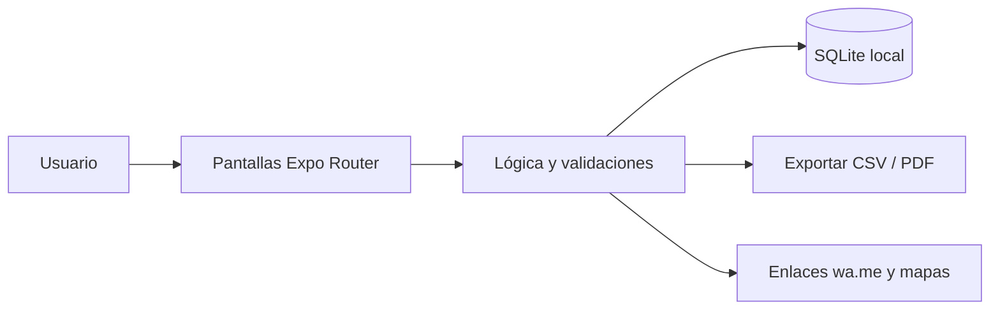

<div align="center">


# LavanderiaYa

**Pedidos de lavandería y tintorería con ticket numerado, estados, saldos por cobrar y aviso por WhatsApp.**

[](LICENSE)
[](https://github.com/LuisRocha2080/LavanderiaYa/actions/workflows/ci.yml)


[Vista rápida](#vista-rápida) · [Características](#características) · [Stack](#stack) · [Roadmap](#roadmap) · [Modelo comercial](#modelo-comercial) · [Inicio rápido](#inicio-rápido) · [Contribuir](#contribuir)

</div>

---

## Vista rápida

| | |
|---|---|
| **Para quién** | Lavanderías de barrio, tintorerías y servicios de planchado |
| **Problema** | Hoy los pedidos se anotan en cuadernos o talonarios: se pierden prendas, se olvida quién pagó adelanto y nadie sabe qué ropa lleva días sin recogerse. |
| **Solución** | App móvil que funciona sin internet y guarda todo en el teléfono. |
| **Costo de licencias** | Bs 0: Expo, React Native, SQLite y TypeScript son de código abierto. |

## Características

- Ticket correlativo por pedido con prendas, cantidades y precio por servicio.
- Estados: recibido → en proceso → listo → entregado.
- Adelantos y saldo pendiente por pedido y por cliente.
- Aviso «tu ropa está lista» por WhatsApp con un toque (enlace wa.me, sin API de pago).
- Alerta de pedidos listos sin recoger hace más de 7 días.
- Cierre de caja diario con totales por método de pago.

Sin servidores, sin suscripciones obligatorias y sin servicios de pago: todos los datos viven en el dispositivo (SQLite).

## Stack

| Capa | Tecnología |
|---|---|
| App | React Native + Expo (TypeScript) |
| Datos | SQLite local (`expo-sqlite`) |
| Navegación | Expo Router |
| Pruebas | Jest + `tsc --noEmit` |
| Distribución | APK directo / EAS Build local |

### Modelo de datos

- `clientes` (id, nombre, telefono, creado_en)
- `servicios` (id, nombre, precio_unidad, unidad (kg / prenda), activo)
- `pedidos` (id, numero, cliente_id, fecha_ingreso, fecha_prometida, estado, total, adelanto)
- `pedido_items` (id, pedido_id, servicio_id, cantidad, detalle)
- `pagos` (id, pedido_id, fecha, monto, metodo (efectivo / QR / transferencia))

Detalle completo: [docs/DATOS.md](docs/DATOS.md).

## Arquitectura



## Roadmap

1. Base y navegación
2. Clientes y servicios
3. Pedidos y estados
4. Pagos y caja
5. Avisos y exportación

Detalle fase por fase: [docs/ROADMAP.md](docs/ROADMAP.md) · [docs/SPEC.md](docs/SPEC.md) · [docs/PLANNING.md](docs/PLANNING.md) · [docs/DATOS.md](docs/DATOS.md) · [docs/PANTALLAS.md](docs/PANTALLAS.md) · [docs/PRUEBAS.md](docs/PRUEBAS.md) · [docs/BACKLOG.md](docs/BACKLOG.md) · [docs/NEGOCIO.md](docs/NEGOCIO.md)

## Modelo comercial

- **Cómo se vende:** Licencia única por negocio (APK) más soporte opcional por WhatsApp.
- **Precio de partida:** Hipótesis a validar: Bs 150–250 pago único o Bs 30 al mes con respaldo asistido.
- **Canal:** Visita directa a lavanderías del barrio y recomendación entre dueños.
- **Piloto:** 5 lavanderías por 30 días, midiendo pedidos registrados por semana y prendas extraviadas.

Los precios son hipótesis para validar con clientes reales antes de fijarlos. Ver [docs/NEGOCIO.md](docs/NEGOCIO.md).

## Estructura

```
LavanderiaYa/
├── app/            # Pantallas y rutas (Expo Router)
├── src/
│   ├── db/         # Esquema y consultas SQLite
│   ├── components/ # Componentes reutilizables
│   └── lib/        # Utilidades
├── docs/           # Roadmap, specs, planificación, datos, pantallas, pruebas, backlog
└── .github/        # Plantillas, CI y Dependabot
```

## Inicio rápido

Requisitos: Node.js 20+ y la app Expo Go (o un emulador).

```bash
git clone https://github.com/LuisRocha2080/LavanderiaYa.git
cd LavanderiaYa
npm install
npx expo start
```

> El repositorio está en **fase inicial**: la documentación y la estructura están listas y el código de la app se construye siguiendo el [roadmap](docs/ROADMAP.md).

## Pruebas

```bash
npm test
npx tsc --noEmit
```

## Seguridad

Los datos no salen del teléfono. Para reportar una vulnerabilidad lee [SECURITY.md](SECURITY.md).

## Lo que todavía no existe

- Un solo dispositivo por negocio: los datos no se sincronizan entre teléfonos.
- No imprime tickets físicos en la primera versión.
- Sin facturación electrónica: emite notas de venta internas, no facturas del SIN.

## Contribuir

Lee la [guía de contribución](CONTRIBUTING.md) y el [código de conducta](CODE_OF_CONDUCT.md). Para dudas, consulta [SUPPORT.md](SUPPORT.md).

## Licencia

Distribuido bajo licencia MIT. Consulta [LICENSE](LICENSE).

---

<div align="center">Hecho por <a href="https://github.com/LuisRocha2080">LuisRocha2080</a></div>
