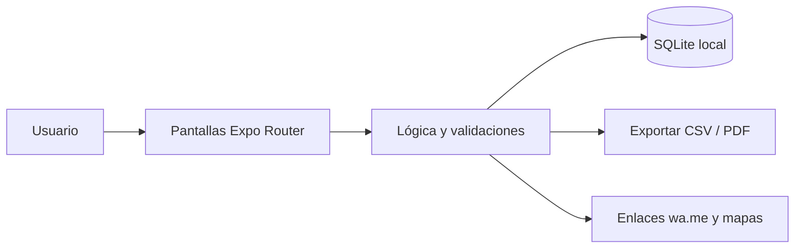

<div align="center">


# 🧺 LavanderiaYa

**Pedidos de lavandería y tintorería con ticket numerado, estados, saldos por cobrar y aviso por WhatsApp.**

[](LICENSE)
[](https://github.com/LuisRocha2080/LavanderiaYa/actions/workflows/ci.yml)


[Inicio rápido](#-inicio-rápido) · [Características](#-características) · [Arquitectura](#️-arquitectura) · [Roadmap](#️-roadmap) · [Pruebas](#-pruebas) · [Limitaciones](#-lo-que-todavía-no-existe) · [Contribuir](#-contribuir)

</div>

Hoy los pedidos se anotan en cuadernos o talonarios: se pierden prendas, se olvida quién pagó adelanto y nadie sabe qué ropa lleva días sin recogerse. **LavanderiaYa** es una app móvil (Android) hecha con React Native + Expo y SQLite local, pensada para lavanderías de barrio, tintorerías y servicios de planchado. Funciona sin internet, sin servidores y sin licencias de pago. **Todavía no es una app lista para usar:** hoy el repositorio contiene la especificación, el plan, el modelo de datos, el diseño de pantallas y la base de configuración; el código de la app llega por fases (ver [Roadmap](#️-roadmap) y [Lo que todavía no existe](#-lo-que-todavía-no-existe)).

## 🎬 Vista rápida

> Aún no hay capturas: la app no está implementada. Las pantallas planificadas están descritas en [docs/PANTALLAS.md](docs/PANTALLAS.md) y se agregarán capturas reales al cerrar la primera fase.

Flujo principal:

```
Inicio → Nuevo pedido → Detalle de pedido → Clientes → Servicios y precios → Caja del día
```

| Pantalla | Qué muestra |
|---|---|
| Inicio | Pedidos del día agrupados por estado y contador de atrasados. |
| Nuevo pedido | Cliente, prendas por servicio, fecha prometida y adelanto. |
| Detalle de pedido | Items, pagos, cambio de estado y botón de aviso por WhatsApp. |
| Clientes | Búsqueda por nombre o teléfono y saldo pendiente. |
| Servicios y precios | Catálogo editable (lavado por kilo, planchado, tintorería por prenda). |
| Caja del día | Ingresos cobrados, saldos por cobrar y exportación CSV. |

## ✨ Características

| Característica | Detalle |
|---|---|
| Ticket correlativo por | Ticket correlativo por pedido con prendas, cantidades y precio por servicio. |
| Estados | Estados: recibido → en proceso → listo → entregado. |
| Adelantos y saldo | Adelantos y saldo pendiente por pedido y por cliente. |
| Aviso «tu ropa | Aviso «tu ropa está lista» por WhatsApp con un toque (enlace wa.me, sin API de pago). |
| Alerta de pedidos | Alerta de pedidos listos sin recoger hace más de 7 días. |
| Cierre de caja | Cierre de caja diario con totales por método de pago. |

Todos los datos viven en el dispositivo (SQLite): sin cuentas, sin suscripciones y sin servicios de pago.

## 🏗️ Arquitectura



| Capa | Tecnología |
|---|---|
| App | React Native + Expo (TypeScript) |
| Datos | SQLite local (`expo-sqlite`) |
| Navegación | Expo Router |
| Pruebas | Jest + `tsc --noEmit` |
| Distribución | APK directo / EAS Build local |

**Modelo de datos**

| Tabla | Campos |
|---|---|
| `clientes` | id, nombre, telefono, creado_en |
| `servicios` | id, nombre, precio_unidad, unidad (kg / prenda), activo |
| `pedidos` | id, numero, cliente_id, fecha_ingreso, fecha_prometida, estado, total, adelanto |
| `pedido_items` | id, pedido_id, servicio_id, cantidad, detalle |
| `pagos` | id, pedido_id, fecha, monto, metodo (efectivo / QR / transferencia) |

<details>
<summary>Estructura de carpetas</summary>

```
LavanderiaYa/
├── app/                 # pantallas (Expo Router)
├── src/
│   ├── components/      # componentes de interfaz
│   ├── db/              # esquema y consultas SQLite
│   └── lib/             # lógica y validaciones
├── docs/                # especificación, roadmap, planificación, datos, pantallas, pruebas, backlog y negocio
├── .github/             # CI, CodeQL, Dependabot, plantillas de issues y PR
├── app.json · package.json · tsconfig.json
└── LICENSE · CHANGELOG.md · CONTRIBUTING.md · SECURITY.md · SUPPORT.md
```

</details>

## 🗺️ Roadmap

1. **Base y navegación:** Proyecto Expo + TypeScript, Esquema SQLite y migraciones, Navegación por pestañas
2. **Clientes y servicios:** CRUD de clientes, Catálogo de servicios y precios
3. **Pedidos y estados:** Nuevo pedido con items, Numeración correlativa, Flujo de estados
4. **Pagos y caja:** Adelantos y saldos, Cierre diario, Alerta de atrasados
5. **Avisos y exportación:** Mensaje de WhatsApp prellenado, Exportación CSV, APK de prueba para 5 lavanderías piloto

Detalle fase por fase en [docs/ROADMAP.md](docs/ROADMAP.md). Documentación completa: [SPEC](docs/SPEC.md) · [PLANNING](docs/PLANNING.md) · [DATOS](docs/DATOS.md) · [PANTALLAS](docs/PANTALLAS.md) · [PRUEBAS](docs/PRUEBAS.md) · [BACKLOG](docs/BACKLOG.md) · [NEGOCIO](docs/NEGOCIO.md).

## 💼 Modelo comercial

| Aspecto | Detalle |
|---|---|
| Cómo se vende | Licencia única por negocio (APK) más soporte opcional por WhatsApp. |
| Precio de partida | Hipótesis a validar: Bs 150–250 pago único o Bs 30 al mes con respaldo asistido. |
| Canal | Visita directa a lavanderías del barrio y recomendación entre dueños. |
| Piloto | 5 lavanderías por 30 días, midiendo pedidos registrados por semana y prendas extraviadas. |

Los precios son hipótesis para validar con clientes reales, no resultados medidos.

## 🚀 Inicio rápido

| Requisito | Versión |
|---|---|
| Node.js | 18+ |
| npm | 9+ |
| Android | Expo Go o emulador |

Clona el repositorio y entra a la carpeta.

```bash
git clone https://github.com/LuisRocha2080/LavanderiaYa.git
cd LavanderiaYa
```

Cuando exista el código de la app (fase 1 del roadmap), se instalará y arrancará así:

```bash
npm install
npm start        # Expo; escanea el QR con Expo Go
npm run android  # o en el emulador
```

> **No verificado:** `package.json` todavía no declara dependencias, así que `npm install` y `npm start` aún no levantan una app. Los scripts `npm test` y `npm run typecheck` sí están definidos y pasan sin pruebas todavía.

<details>
<summary>Variables de entorno</summary>

LavanderiaYa no usa variables de entorno ni claves de API: todo funciona en el dispositivo. `.env.example` queda como plantilla vacía por si se agrega una integración (declarala sin valores reales).

</details>

## 🧪 Pruebas

Casos que la suite debe cubrir (definidos en [docs/PRUEBAS.md](docs/PRUEBAS.md)):

- Totales y saldos con casos límite (adelanto = total, adelanto > total).
- Numeración correlativa tras borrar y reiniciar la app.
- Cierre de caja con pagos de días distintos.
- Mensaje de WhatsApp con teléfonos con y sin código de país (+591).
- Funcionamiento en modo avión.

Hoy `npm test` corre Jest sin pruebas (`--passWithNoTests`) y `npm run typecheck` ejecuta `tsc --noEmit`. El pipeline de CI y el análisis CodeQL corren en GitHub Actions en cada push y PR a `main`.

## 🔒 Seguridad

**Implementado:** no hay cuentas, contraseñas ni servidores; no se envían datos a terceros. El repositorio tiene activados el reporte privado de vulnerabilidades, Dependabot y la protección de secretos, y hay un workflow de CodeQL.

**Avisos importantes:**

- La base SQLite local no está cifrada: quien tenga acceso al dispositivo desbloqueado puede ver los datos.
- No hay copia de respaldo en la nube; si se pierde el teléfono se pierden los datos (la exportación a CSV/PDF está prevista en el diseño, ver [docs/SPEC.md](docs/SPEC.md)).
- Los problemas de seguridad se reportan según [SECURITY.md](SECURITY.md).

## 🚧 Lo que todavía no existe

- **La app en sí:** el repositorio es la base documental y de configuración; las pantallas, la base de datos y la lógica se construyen fase por fase (ver Roadmap).
- Un solo dispositivo por negocio: los datos no se sincronizan entre teléfonos.
- No imprime tickets físicos en la primera versión.
- Sin facturación electrónica: emite notas de venta internas, no facturas del SIN.
- Sin capturas de pantalla, sin pruebas automáticas reales y sin APK publicado.
- Los precios y el piloto del modelo comercial son hipótesis sin validar.

## 🤝 Contribuir

¡Las contribuciones son bienvenidas! Leé la [guía de contribución](CONTRIBUTING.md) y el [código de conducta](CODE_OF_CONDUCT.md) antes de abrir un PR. Para bugs o ideas usá las plantillas de issues; los problemas de seguridad se reportan según la [política de seguridad](SECURITY.md). ¿Dudas? Mirá [SUPPORT.md](SUPPORT.md). Los cambios por versión están en el [CHANGELOG](CHANGELOG.md).

## 📄 Licencia

Distribuido bajo la licencia MIT. Ver [LICENSE](LICENSE).

---

<div align="center">Hecho por <a href="https://github.com/LuisRocha2080">LuisRocha2080</a> · pedidos de lavandería y tintorería con ticket numerado, estados, saldos por cobrar y aviso por whatsapp. con React Native, Expo y SQLite</div>
